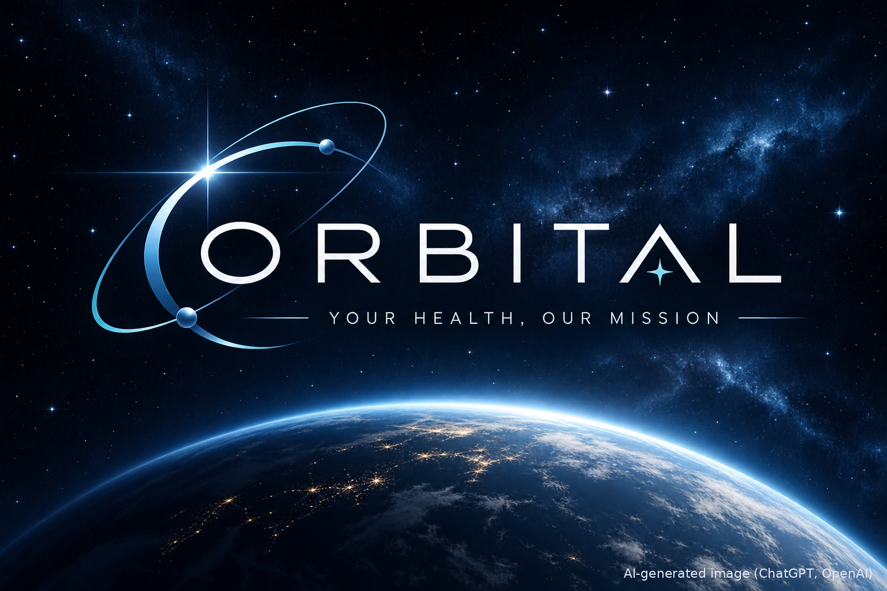
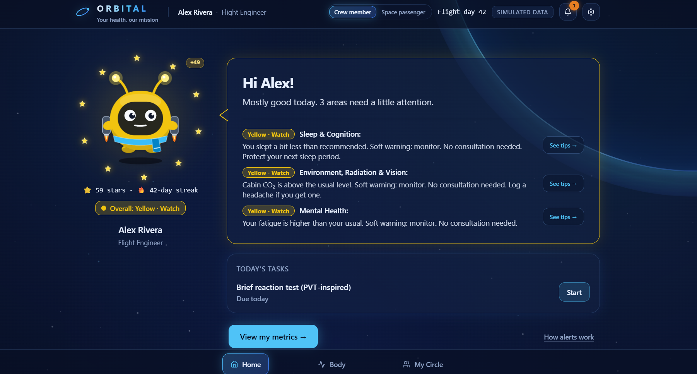
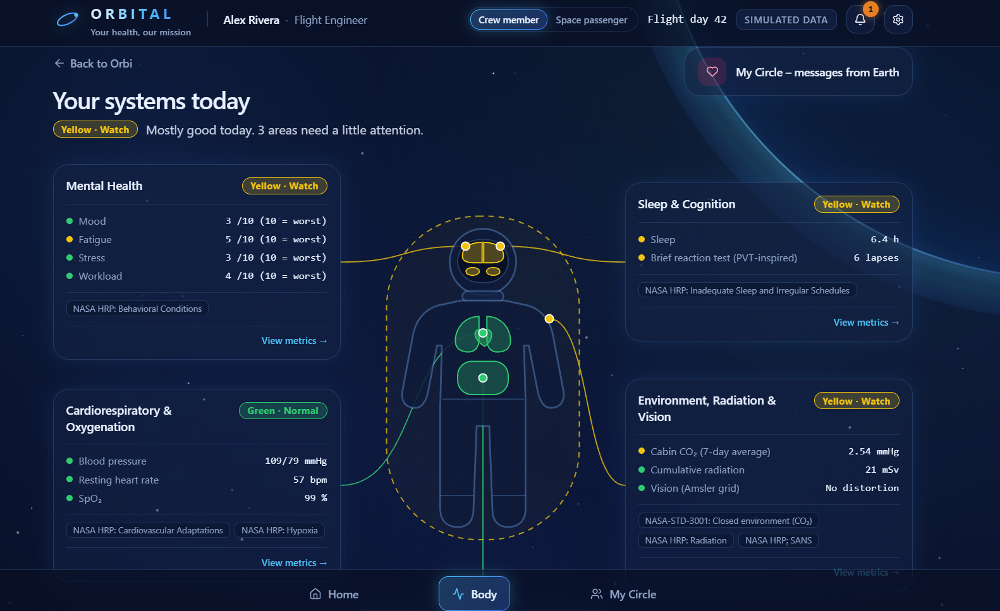
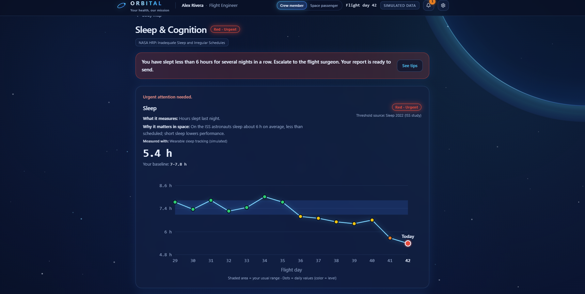
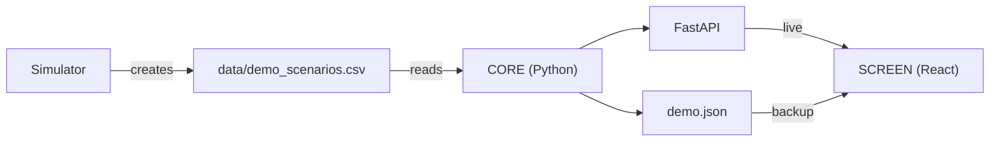

<div align="center">

# ORBITAL

### YOUR HEALTH, OUR MISSION

**Onboard health monitoring for long-duration spaceflight.**

[**LIVE DEMO**](https://orbital-lovat.vercel.app) · [**HOW IT DECIDES**](#4-how-orbital-decides-personal-baseline--clinical-thresholds) · [**ARCHITECTURE**](#9-architecture) · [**RUN IT LOCALLY**](#10-run-it-locally)


</div>

ORBITAL watches each astronaut's key health indicators, compares them with clinical standards **and with the astronaut's own normal**, and turns every result into a clear color, a plain-language explanation and the right person to notify — on board, without depending on Earth.

> 🚀 **Live demo:** https://orbital-lovat.vercel.app (shows the core's precomputed results for 4 scenarios; live recalculation runs locally, see [§9](#9-architecture))
>
> 🧪 **All data in this project is simulated.** ORBITAL guides; it does not diagnose. It is an experimental prototype, not a medical device.

**NASA Space Apps Challenge 2026** · Challenge: *Create Health Monitoring Software for Astronauts on Space Missions*  
Team **The Foxhole Court** · UCEL Rosario, Argentina

---

## Contents

| | |
| --- | --- |
| [1 — Why ORBITAL](#1-why-orbital) | [9 — Architecture](#9-architecture) |
| [2 — What ORBITAL monitors](#2-what-orbital-monitors) | [10 — Run it locally](#10-run-it-locally) |
| [3 — Built on NASA's standards](#3-built-on-nasas-standards) | [11 — Verification and tests](#11-verification-and-tests) |
| [4 — How ORBITAL decides](#4-how-orbital-decides-personal-baseline--clinical-thresholds) | [12 — Limitations and future work](#12-limitations-and-future-work) |
| [5 — Colors, meaning and who is notified](#5-colors-meaning-and-who-is-notified) | [13 — Use of AI (SI)](#13-use-of-ai-si) |
| [6 — The experience](#6-the-experience) | [14 — References](#14-references) |
| [7 — Space passenger mode](#7-space-passenger-mode) | [15 — Team and license](#15-team-and-license) |
| [8 — The demo: one astronaut, four scenarios](#8-the-demo-one-astronaut-four-scenarios) | |

---

## 1. Why ORBITAL

Every astronaut on board is critical to the mission. A health problem that is **detected late, or handled with the wrong procedure**, can compromise not only the mission but the astronaut's own health.

On long missions this risk grows:

- **Distance:** communication with Earth can take **up to 20 minutes each way**, so crews must solve medical problems with limited help from the ground ([NASA HRP – Distance from Earth](https://www.nasa.gov/hrp/hazard-distance-from-earth/)).
- **Data spread across systems:** NASA and the Canadian Space Agency (CSA) already collect several of these signals in specific studies and tools (e.g., NASA Standard Measures, CSA Bio-Monitor and Space Health), often reviewed by teams on the ground. ORBITAL is a **proposal** to bring them together in one place and support decisions **on board**.
- **Everyone is different:** in microgravity physiology changes, so a value that is "normal" for the population may be a warning sign for one particular astronaut.

**ORBITAL closes that gap:** it analyzes the data **on board**, compares each astronaut **with themselves**, works **offline**, and tells the astronaut, at all times, *what is happening and why*.

<div align="center">

**OBSERVE → ACT → VERIFY → ESCALATE**

</div>

---

## 2. What ORBITAL monitors

Thirteen measurements, grouped in **five health blocks**. Each one watches an official risk from the **NASA Human Research Program (HRP)** or a documented spaceflight effect.

| Block | Measurement | How it is measured | Official risk it watches | Threshold source |
| --- | --- | --- | --- | --- |
| **Cardiorespiratory & Oxygenation** | Blood pressure | Wearable biomonitor | NASA HRP: Cardiovascular Adaptations | AHA |
| | Resting heart rate | Wearable biomonitor | NASA HRP: Cardiovascular Adaptations | AHA |
| | SpO₂ | Wearable biomonitor | NASA HRP: Hypoxia | WHO |
| **Sleep & Cognition** | Sleep hours | Wearable sleep tracking | NASA HRP: Inadequate Sleep and Irregular Schedules | ISS sleep study (*Sleep*, 2022) |
| | Brief reaction test (PVT-inspired, lapses) | In-app test | NASA HRP: Inadequate Sleep / Behavioral Conditions | Personal baseline |
| **Metabolic & Internal Balance** | Glucose | Onboard glucometer | CSA: insulin resistance in spaceflight | ADA |
| **Environment, Radiation & Vision** | Cabin CO₂ | Habitat air sensor | Closed environment (NASA-STD-3001) | NASA-STD-3001 |
| | Cumulative radiation | Personal dosimeter | NASA HRP: Radiation | NASA-STD-3001 |
| | Vision (Amsler grid) | In-app test | NASA HRP: SANS (neuro-ocular syndrome) | Personal baseline |
| **Mental Health** | Mood (daily check-in, 0–10) | Self-report | NASA HRP: Behavioral Conditions | Personal baseline |
| | Fatigue (0–10) | Self-report | NASA HRP: Behavioral Conditions / Inadequate Sleep | Personal baseline |
| | Stress (0–10) | Self-report | NASA HRP: Behavioral Conditions | Personal baseline |
| | Workload (0–10) | Self-report | NASA HRP: Behavioral Conditions | Personal baseline |

The four check-in scales are a **simplified 0–10 self-report inspired by the visual analog scales (VAS)** used on the ISS (10 = worst); they are not the same instrument as the 0–100 VAS. Each one is a separate indicator, compared with the astronaut's own baseline. The check-in also has four **symptom** boxes: dizziness and feeling faint feed the low blood pressure rule, headache feeds the CO₂ rule (high CO₂ **with** a headache is orange); cold sore or rash is only recorded, because temperature is not in the MVP.

📄 Rationale per risk: [`riesgos-nasa.md`](.claude/skills/fisiologia-espacial/references/riesgos-nasa.md) · Thresholds: [`umbrales.md`](.claude/skills/fisiologia-espacial/references/umbrales.md) · Scales and protocols: [`escalas-y-protocolos.md`](.claude/skills/fisiologia-espacial/references/escalas-y-protocolos.md)

---

## 3. Built on NASA's standards

ORBITAL follows what NASA's crew health standard actually asks for:

- **NASA-STD-3001 (Vol. 1, Rev. C)** requires vital signs to be **assessed, recorded, monitored and trended in flight** (V1 3004) and refers to current U.S. clinical standards for the values (V1 3000). That is exactly ORBITAL's design: vital-sign cut-offs come from **AHA, WHO and ADA**, and every reading is **trended against the astronaut's own baseline**.
- **Limits set by NASA-STD-3001** are used directly: cabin CO₂ (7-day average < 2.5 mmHg; 1-hour average > 3 mmHg is critical, OCHMO-TB-004) and radiation (career limit **600 mSv**, **250 mSv** per solar event, V1 4030–4031).
- **Every indicator maps to an official NASA HRP risk** (table above). Glucose follows the CSA's finding of insulin resistance in spaceflight.
- **In-app tests based on protocols used on the ISS:** a **brief reaction test inspired by the PVT-B** (ISS crews took the PVT about every 4 days in the Reaction Self Test) and the **Amsler grid**, one of the vision checks done on the ISS for SANS. The demo PVT lasts **1 minute** (the scales document allows it for the demo); the 355 ms lapse cut is validated for the **3-minute** PVT-B (Basner 2011), so ORBITAL only compares lapses with the astronaut's own sessions of the same length. It is an experimental, PVT-inspired measure, not the validated PVT-B.
- **Personal baseline**, as in NASA Standard Measures and Artemis II: each astronaut is compared with themselves before and during flight.
- **Simulated wearable data** is modeled on the signals of CSA's Bio-Monitor / Astroskin (heart rate, blood pressure, SpO₂, activity).

Every threshold lives in one file, with its source next to each value: [`backend/core/thresholds.py`](backend/core/thresholds.py). Values that are design choices of the team, without a source that fixes that exact number, are marked **Proposal**.

---

## 4. How ORBITAL decides: personal baseline + clinical thresholds

ORBITAL evaluates every reading in **two layers** and keeps the more serious result.

### Layer 1 — Clinical thresholds (the same for everyone)
Fixed cut-offs from AHA, WHO, ADA and NASA-STD-3001 → [`backend/core/clinical.py`](backend/core/clinical.py)

### Layer 2 — Personal baseline (what is normal *for this astronaut*)
1. **Baseline:** during flight days **4 to 10**, ORBITAL learns the astronaut's normal: the **mean** and the **standard deviation** of each measurement → [`backend/core/baseline.py`](backend/core/baseline.py). It needs at least **5 of the 7 days** (the PVT, which is every few days: at least 3 sessions).
2. **z-score:** for every new reading it computes how far it is from that normal, in standard deviations:

   $$z = \frac{\text{today's value} - \text{baseline mean}}{\text{baseline standard deviation}}$$

   `z = 0` means "as usual"; `z = 2` means "far from usual".
3. **Sustained change, not a single blip:** a deviation counts only when it repeats → [`backend/core/escalation.py`](backend/core/escalation.py)
   - **Yellow:** |z| ≥ 1.5 in **3 measurements in a row**.
   - **Orange:** |z| ≥ 2 in **3 measurements in a row**.
   - The reaction test uses its own rule: yellow at |z| ≥ 1.5 in one session, orange in 3 sessions in a row.

### When the baseline cannot be used
If there are too few baseline values, or they have no spread, ORBITAL **does not assume normality**. Measurements that rely only on the baseline (the four check-in scales and the PVT) are shown as **Not evaluable**; the others keep their clinical level and flag that the personal comparison was not possible (`baseline_available: false`). Absence of evidence is never shown as green.

Sleep, cabin CO₂, radiation and the Amsler grid use clinical or protocol rules only (no baseline layer), as defined in [`alert_texts.md`](docs/content/alert_texts.md).

### Final level
- **The higher level of the two layers wins.**
- **A baseline deviation alone never reaches red** — red is reserved for clinical thresholds.
- Each block takes the level of its worst measurement, and the overall status takes the worst block.

This is what makes ORBITAL different: a resting heart rate of **66 bpm** is perfectly normal for the population, but if this astronaut's normal is 60 ± 2.5 bpm and it stays at 66 for three days, ORBITAL raises it (see the *Attention* scenario below).

---

## 5. Colors, meaning and who is notified

| Level | Meaning | What the astronaut does | Who is notified |
| --- | --- | --- | --- |
| 🟢 **Green · Normal** | Within the expected range | Keep the routine | No one |
| 🟡 **Yellow · Watch** | Moving away from *your* usual values, still inside the clinical range (or at its edge) | Repeat the measurement, follow the self-care tips | No one — it stays between the astronaut and ORBITAL |
| 🟠 **Orange · Attention** | Out of the clinical range, or a marked change sustained for several days | Contact the onboard doctor | Onboard doctor + flight surgeon on Earth |
| 🔴 **Red · Urgent** | Critical value | Stop and get help now | Onboard doctor + flight surgeon on Earth (URGENT) + a crewmate on board |

On-board alerts are immediate; messages to Earth go out in the next communication window.

### Clinical thresholds per measurement

| Measurement | 🟢 Green | 🟡 Yellow | 🟠 Orange | 🔴 Red | Source |
| --- | --- | --- | --- | --- | --- |
| Blood pressure (mmHg) | < 130 / < 80 | baseline deviation | 130–180 / 80–120, or < 90/60 with symptoms | > 180 and/or > 120 | AHA; NHLBI |
| Resting heart rate (bpm) | 50–100 | baseline deviation | 40–49 or 101–120 | < 40 or > 120 | AHA (green from 50: athletic profile) |
| SpO₂ (%) | ≥ 95 | 94 | 91–93 | ≤ 90 | WHO; red at exactly 90 % is a Proposal |
| Glucose (mg/dL) | 70–180 | baseline deviation | 54–69 or 181–250 | < 54 or > 250 | ADA |
| Sleep (h/night) | ≥ 7 | 6–7 | < 6 one night | < 6 two nights in a row | ISS sleep study; cuts: Proposal |
| Cabin CO₂ (mmHg) | < 2.5 (7-day avg) | 2.5–3 | 2.5–3 with headache | > 3 (1-hour avg) | NASA-STD-3001 |
| Radiation (% of 600 mSv career limit) | < 50 % | 50–65 % | ≥ 65 % | solar storm in progress | NASA-STD-3001; percentages: Proposal |
| PVT, check-in scales | personal baseline | | | | escalas-y-protocolos.md (Proposal) |
| Amsler grid | no change | change not repeated | change confirmed | sudden loss or growing area | Proposal |

**Radiation is tracked as long-term exposure, not as an operational alarm:** the cumulative dose reaches orange at most, and red is reserved for an operational event, a solar particle event in progress (team decision, provisional). Dose rate is future work.

On-screen texts for every measurement and level come from one file: [`docs/content/alert_texts.md`](docs/content/alert_texts.md).

---

## 6. The experience

ORBITAL is designed to be **easy, intuitive and informative**: the astronaut should always know *what is happening and why*.

| Screen | What it does | Code |
| --- | --- | --- |
| **Home — Orbi** | Orbi, an original mascot, takes the color of the overall status and explains it in a speech bubble: what is affected, a short recommendation and who was notified. "Today's tasks" lists the tests that are due. | [`HomePage.tsx`](frontend/src/pages/HomePage.tsx), [`OrbiMascot.tsx`](frontend/src/components/OrbiMascot.tsx) |
| **Body map** | A silhouette linked to the 5 blocks, each card in its level color and with the NASA risk it watches. | [`BodyMapPage.tsx`](frontend/src/pages/BodyMapPage.tsx), [`BodySilhouette.tsx`](frontend/src/components/BodySilhouette.tsx) |
| **Block dashboards** | Current value, level, threshold source, "your usual range" and a 14-day trend chart for each measurement, with "what it measures" and "why it matters in space". | [`BlockDetailPage.tsx`](frontend/src/pages/BlockDetailPage.tsx), [`IndicatorChart.tsx`](frontend/src/components/IndicatorChart.tsx) |
| **In-app tests** | Brief PVT-inspired reaction test (1-min demo), Amsler grid (one eye at a time) and the daily 0–10 check-in, each with a short explanation before starting. The screen only records raw data; the core scores it. | [`PvtTestPage.tsx`](frontend/src/pages/PvtTestPage.tsx), [`AmslerTestPage.tsx`](frontend/src/pages/AmslerTestPage.tsx), [`MentalCheckinPage.tsx`](frontend/src/pages/MentalCheckinPage.tsx) |
| **Mental health** | Private journal (stored only on the device, never shared) and a guided breathing exercise. | [`MentalJournalPage.tsx`](frontend/src/pages/MentalJournalPage.tsx), [`MentalBreathingPage.tsx`](frontend/src/pages/MentalBreathingPage.tsx) |
| **Self-care tips** | Concrete steps for each affected indicator; steps backed by NASA practice are labeled. | [`TipsDrawer.tsx`](frontend/src/components/TipsDrawer.tsx), [`tips.ts`](frontend/src/data/tips.ts) |
| **Reminders and rewards** | Bell and reminders for due tests; Orbi collects stars for **completing** tests (never for results, so self-reports stay honest). | [`TopBar.tsx`](frontend/src/components/TopBar.tsx) |
| **My Circle** | Keeps the astronaut close to loved ones on Earth: messages are queued while offline and sent in the next communication window, with the signal delay shown. Designed with end-to-end encryption (not implemented in this prototype). | [`CirclePage.tsx`](frontend/src/pages/CirclePage.tsx) |
| **How alerts work** | Explains each color, what to do, who is notified and where each data point comes from. | [`AlertsInfoPage.tsx`](frontend/src/pages/AlertsInfoPage.tsx) |

### Screenshots

Captured from the running application with the simulated demo data.

**Home — Orbi** (*Deterioration* scenario, flight day 42)



**Body map** (*Deterioration* scenario, flight day 42)



**Block dashboard — Sleep & Cognition** (*Emergency* scenario, flight day 42)



---

## 7. Space passenger mode

Commercial spaceflight is opening space to people who are not professional astronauts. With the **Crew member | Space passenger** switch, ORBITAL offers a simplified, friendly version for them:

- **Simpler health view:** the same five blocks and colors, explained in everyday language, with simple trend charts.
- **Statistics adapted to non-athletes** (applied in the passenger demo data; moving them into the core is future work):
  - Resting heart rate green is **60–100 bpm** (AHA normal range), instead of 50–100 for the athletic astronaut profile.
  - Baseline from **pre-flight days only**: commercial flights are too short for a baseline in flight days 4–10.
  - Mission-long tests (PVT, Amsler) are hidden; the daily check-in and the breathing exercise stay.
- **A social side — Space moments:** live trip stats (altitude, speed, sunrises per day), a photo gallery and posts queued to share when there is connection. Health data is never included in posts.
- **Their own My Circle**, with a signal delay of under a second in low Earth orbit.

In this prototype passenger data is fixed demo data. Age and pre-existing conditions need individual medical evaluation and are future work.

---

## 8. The demo: one astronaut, four scenarios

The demo follows **one fictional astronaut** (`SIM-02`, Alex Rivera, Flight Engineer, Mars transit) over **42 continuous flight days**. The database is [`data/demo_scenarios.csv`](data/demo_scenarios.csv), generated by [`backend/simulator/demo_scenarios.py`](backend/simulator/demo_scenarios.py) (documented in [`data/README.md`](data/README.md)). Levels are **not** stored in the data: the core computes them.

| Scenario | Story | Day 42 |
| --- | --- | --- |
| 🟢 **Healthy** | Everything in the usual range | Green — no alert on any of the 42 days |
| 🟡 **Deterioration** | From day 33 cabin CO₂ rises, sleep shortens, the reaction test worsens and fatigue goes up | Yellow: sleep, CO₂, PVT, fatigue |
| 🟠 **Attention** | Resting heart rate 66–67 bpm on days 40–42: clinically normal, but a sustained marked deviation from Alex's own baseline | Orange: heart rate (personal baseline) |
| 🔴 **Emergency** | Two nights under 6 h and SpO₂ 89 % with a headache | Red: SpO₂ and sleep |

Switch scenarios from the ⚙️ menu in the top bar. Running locally with the API, taking the reaction test slowly on purpose makes the core **recalculate live** and the PVT turn yellow.

---

## 9. Architecture



| Layer | What it does | Files |
| --- | --- | --- |
| **Data** | Simulated demo database; hand-written clinical answer key | [`data/`](data/), [`backend/storage.py`](backend/storage.py) |
| **Core** | Baseline, z-scores, clinical layer, deviation layer, final level, escalation, raw test scoring. No UI code. | [`backend/core/`](backend/core/) |
| **API** | Serves status and series; receives check-ins, PVT sessions and Amsler results and recalculates | [`backend/api/main.py`](backend/api/main.py) |
| **Backup file** | The core's results for all scenarios, so the demo never depends on the API | [`backend/export_demo.py`](backend/export_demo.py) → [`frontend/src/data/demo.json`](frontend/src/data/demo.json) |
| **Screen** | React + TypeScript + Vite. **Computes nothing clinical**: it shows what the core returns. Tries the API (on localhost), then `demo.json`. | [`frontend/`](frontend/), [`source.ts`](frontend/src/data/source.ts) |

**Works offline:** everything runs on board; nothing needs a connection to Earth.

**Why the public link uses `demo.json`:** the demo API keeps one shared session in memory (no users, no persistence), so publishing it would let one visitor's test change what another sees, and free servers take up to a minute to wake up. The public site therefore shows the core's precomputed results; the live recalculation is shown running locally. Deploying the API with sessions and storage is future work.

---

## 10. Run it locally

**Requirements:** Python 3.11, Node.js 20+.

```bash
# 0. Clone the repository
git clone https://github.com/paulinaguers/orbital.git
cd orbital

# 1. Backend: install and test
pip install -r backend/requirements.txt
python -m pytest                          # 56 tests

# 2. (Optional) regenerate the demo data and the backup file
python -m backend.simulator.demo_scenarios
python -m backend.export_demo

# 3. Start the core API  →  http://localhost:8000/docs
uvicorn backend.api.main:app --reload

# 4. In a second terminal, start the screen  →  http://localhost:3000
cd frontend
npm install
npm run dev
```

The ⚙️ menu shows the data source: **Live core (API)**, **Demo file** or **Mock data**.

---

## 11. Verification and tests

- **Clinical answer key:** [`data/clinical_test_cases.csv`](data/clinical_test_cases.csv) — 188 hand-written days covering every level and the main threshold boundaries of the 10 measurements, written from the alert texts and the clinical skill, **independently of the core's code** (case list: [`docs/content/clinical_test_cases.md`](docs/content/clinical_test_cases.md)). The core matches **every non-pending expected level (more than 1,500 comparisons)** → [`test_core_vs_clinical_cases.py`](backend/tests/test_core_vs_clinical_cases.py)
- **No false alarms:** the healthy scenario stays green for all 42 days → [`test_demo_scenarios.py`](backend/tests/test_demo_scenarios.py)
- **Live recalculation and input checks:** API tests for check-in (including symptoms), PVT (omissions, invalid sessions, impossible values) and Amsler (including the red "sudden change") → [`test_api.py`](backend/tests/test_api.py)
- **Not evaluable, never green:** unit tests for flat or incomplete baselines, radiation rules and API input checks → [`test_core_units.py`](backend/tests/test_core_units.py)
- **56 automated tests** in [`backend/tests/`](backend/tests/); the frontend build includes a TypeScript type check.

> **What this proves, and what it does not.** These tests show that the code applies the rules the team defined, consistently (internal verification). They do **not** show that the rules are clinically right for astronauts: that needs clinical validation with real data, which is out of the scope of a hackathon.

**Open clinical decisions.** Some rules still need a team decision (what "sustained" means, single extreme readings, exact boundaries such as 7 h of sleep). The core applies a conservative **provisional** answer to each one — when in doubt, the higher level — marked PROVISIONAL in the code and listed in the [logbook](BITACORA.md).

---

## 12. Limitations and future work

- **Simulated data only;** not validated with real astronauts. ORBITAL is not a medical device.
- **Earth-based clinical thresholds** (AHA, WHO, ADA) are what NASA-STD-3001 points to, but they need clinical review before being applied in microgravity; the personal baseline layer partly addresses this.
- **Brief PVT:** the 1-minute demo is PVT-inspired and experimental. Unanswered stimuli (no answer within 3 s) count as lapses, sessions are compared as a lapse rate, and sessions with fewer than 5 stimuli are not evaluable (all Proposal). False starts are recorded but not scored yet. There is no practice phase: the protocol asks for 2–3 practice sessions before the baseline, and the demo data uses calibration sessions every 2 days (days 4–10) and every 4 days afterwards; a real version should add practice sessions excluded from the baseline, or use pre-flight data. A 3-minute mode would match the validated PVT-B.
- **Radiation:** cumulative dose caps at orange, even past 100 % of the 600 mSv career limit (Proposal); a crossed limit is not yet flagged separately. The 250 mSv per-event limit is not computed: a solar particle event in progress is red. Dose rate is not modeled.
- **Measurement protocols:** a red blood pressure reading should be repeated after 5 minutes and an isolated low SpO₂ re-checked; the core classifies the reading as entered. Glucose has no fasting/after-meal context.
- **Sources to read with care:** the WHO SpO₂ reference comes from a guideline on oxygen therapy for children; green heart rate from 50 bpm is a team adaptation for a trained profile, not the general AHA range. All thresholds are an experimental hackathon proposal, not a NASA clinical protocol.
- **Charts:** for sleep and CO₂ the "usual range" band is descriptive only (alerts use fixed thresholds); the Amsler grid compares each test with the previous one, and a change is confirmed only if the same area is marked again. Each block reports how many of its indicators were evaluated, so a partial result is not read as a complete one.
- **No de-escalation rule:** a level can drop as soon as one reading falls below the cut (no hysteresis), which may flicker near a threshold.
- **Demo API:** one shared in-memory session, no authentication; new results are lost on restart; an unknown flight day is rejected.
- **Simulated communications:** notifications to the onboard doctor, flight surgeon and crewmate are computed but not delivered; My Circle message delivery is simulated; the private journal is stored on the device but not encrypted.
- **Baseline length:** with only 7 baseline days, the standard deviation can come out too narrow by chance and give very large z-scores. Future: a minimum spread, a longer or more robust baseline, or a pre-flight baseline.
- **Rolling baseline (future improvement).** Today the baseline is fixed: flight days 4–10, for the whole mission. With 7 values the standard deviation is imprecise (the true one can be roughly 0.6 to 2.2 times the estimate, 95 % interval), and the body keeps adapting to microgravity for months, so a day-10 baseline can be out of date by month 4. A future version would use a **rolling window** (for example, the last 30 days) recalculated every day, so the usual range follows the astronaut's adaptation. Known risk: a slow decline would be absorbed into "normal" and stop being flagged. To limit it, the clinical layer stays unchanged and the original days 4–10 baseline would be kept as a second reference. Proposal.
- **Machine learning layer:** designed but left out of the MVP on purpose. See the proposal below.
- **Passenger mode in the core** (thresholds by profile), conditions and age for commercial passengers.
- **Persistent storage** (SQLite), real device integration, and implemented end-to-end encryption for My Circle.
- **Exercise, body mass, temperature and immune signals** are documented as next indicators.
- **Frontend tests and CI** (GitHub Actions running the tests on every push).

### Proposal: anomaly-detection layer (future work, not implemented)

> **Status: Proposal.** Nothing in this section runs in the current app. It describes how a machine learning layer would be added on top of the rules engine, and why we did not build it for the hackathon.

**Why it would help.** The current core looks at **one measurement at a time**: each value is compared with clinical thresholds and with the astronaut's own baseline (z-score). It cannot see a **combination** of small changes. Example: heart rate a little higher, sleep a little shorter, fatigue a little higher and SpO₂ a little lower on the same days. Each one stays green on its own, but together they can be the first sign of a problem (poor sleep, a CO₂ build-up, an early infection). The layer would flag that kind of pattern.

**What it would never do.** It would not replace the rules, would not diagnose and would not escalate to Earth on its own:

- It runs **next to** the two layers already in place (clinical thresholds and personal baseline). The final level is still the higher one.
- Its alert is **yellow at most** ("Several of your values are changing together. Keep an eye on them."). Like a baseline deviation, it never reaches red.
- It always says **which measurements** pushed the score up, so the astronaut and the onboard doctor can check them.
- It is **unsupervised**: it learns what is normal for each astronaut, not a disease. A supervised risk model would need real astronaut data with clinical outcomes, which does not exist publicly; trained on our simulated data, it would only learn back the rules we wrote (a circular result).

**Input.** One row per astronaut per day with the z-scores the core already computes: systolic and diastolic blood pressure, resting heart rate, SpO₂, glucose, sleep hours, and the four check-in scales. Missing values (a test not done that day) are left out of that day's score, not filled in.

**Cold start: the layer switches on in stages.** The app starts being used in flight, with no history. A model that learns "normal" for one person cannot work on day 1, so it activates step by step and the rules always keep protecting the astronaut:

| Stage | Data available for this astronaut | What runs | Screen |
| --- | --- | --- | --- |
| **0 · No data** | Flight days 1–3 | Clinical thresholds only | — |
| **1 · Little data** | Baseline days 4–10 (7 days) | **Combined deviation score**: sum of the day's squared z-scores, compared with a chi-square distribution with *k* degrees of freedom (*k* = measurements that day). Score above the 99th percentile on 2 days in a row → yellow. It needs no covariance, so it works with 7 days. | "Pattern check: learning your usual values" until day 10 |
| **2 · Enough data** | About 30+ days of readings | **Mahalanobis distance** on the z-scores, with a shrinkage covariance estimate (Ledoit-Wolf) so it stays stable with few days. It also learns which measurements usually move together for this person (e.g., short sleep and higher fatigue). | "Pattern check: active" |
| **2b · Dense data** | Hundreds of readings (continuous wearable, e.g. CSA Bio-Monitor) | **Isolation Forest** trained on that astronaut's own normal periods; useful when there are many readings per day | "Pattern check: active" |

**Pre-flight data would remove the cold start.** Astronauts have months of medical checks before flight (NASA Standard Measures collects data about 270 and 180 days before launch; Zwart 2018). If the app could load them, stage 2 would start on flight day 1. We present this as a possibility, without claiming which data NASA would make available.

**How we would know it works.** Before turning it on, the engine would run twice on the same simulated missions, with and without the layer, against anomalies injected on known days:

| Metric | Question |
| --- | --- |
| Detection day | Does it flag the injected pattern **earlier** than the rules alone? |
| False alarms | Does the healthy scenario stay green for all 42 days? |
| Added alerts | How many extra yellow days does it add, and are they explainable? |

Acceptance rule (the team's "cut 2"): the layer is kept only if it detects earlier **without** more false alarms than the rules. Otherwise it stays off and remains future work. Any result on simulated data shows internal consistency only; clinical value needs validation with real astronaut data.

**Where it would live in the code.** `backend/core/ml/` (no interface imports, like the rest of the core), in a separate `ml` branch until it passes the evaluation. Libraries: numpy and scikit-learn (open source). It would add one field per day to the API and to `demo.json` (`pattern_score`, `pattern_level`, `pattern_drivers`) and one card in the Sleep & Cognition and Mental Health views.

**Why it is not in the MVP.** With 7 baseline days per astronaut, a model has almost nothing to learn from: an Isolation Forest needs hundreds of readings per person, and a full Mahalanobis covariance with 9 measurements and 7 days is close to singular. We preferred a rules engine we can explain and verify, plus an honest plan for the model.

---

## 13. Use of AI (SI)

ORBITAL was built with **AI-assisted development with human oversight**. The idea, the clinical criteria and every decision are the team's; AI was used to research, organize, write code and document.

| Tool | Used for |
| --- | --- |
| **Claude** (Anthropic, Opus 5.5) — chat, Claude Code, reviewer and coordinator subagents, project skills | Literature search, documents, prompts for the screens, the core, API, simulator, tests, checks and this README |
| **Google AI Studio** (Gemini) | Generating the React screens from prompts reviewed by the team |
| **ChatGPT** (OpenAI) | Visual layout of this README and the banner image (watermarked as AI-generated); content checked by the team against the previous README |

- Every code file starts with `# Generated with SI assistance (Claude), reviewed by the ORBITAL team.` (or `//` in TypeScript).
- Every step, the tool used and what a person reviewed are in the logbook: [`BITACORA.md`](BITACORA.md).

---

## 14. References

- NASA OCHMO. *NASA-STD-3001 Vol. 1 Rev. C: Crew Health* (2023). https://www.nasa.gov/wp-content/uploads/2023/11/nasa-std-3001-vol-1-rev-c-with-signature.pdf
- NASA OCHMO. *Carbon Dioxide Technical Brief, OCHMO-TB-004*. https://www.nasa.gov/?p=841628
- NASA OCHMO. *Radiation Protection Technical Brief* (2022). https://www.nasa.gov/wp-content/uploads/2023/03/radiation-protection-technical-brief-ochmo.pdf
- NASA Human Research Program. *Risks of Human Spaceflight*. https://www.nasa.gov/hrp/risks/
- Basner, M., Mollicone, D., & Dinges, D. F. (2011). Validity and sensitivity of a brief psychomotor vigilance test (PVT-B). *Acta Astronautica*. https://pmc.ncbi.nlm.nih.gov/articles/PMC3197786
- *Sleep deficiency in spaceflight is associated with degraded neurobehavioral functions* (2022). *Sleep*. https://pmc.ncbi.nlm.nih.gov/articles/PMC8919197
- Barger, L. K., et al. (2014). Sleep deficiency in astronauts. *The Lancet Neurology*. https://pmc.ncbi.nlm.nih.gov/articles/PMC4188436
- Brunstetter, T. (2017). *Introduction to SANS*. NASA. https://ntrs.nasa.gov/api/citations/20170009173/downloads/20170009173.pdf
- American Heart Association. *Understanding blood pressure readings*. https://heart.org/bplevels
- American Heart Association. *All about heart rate*. https://www.heart.org/en/health-topics/high-blood-pressure/the-facts-about-high-blood-pressure/all-about-heart-rate-pulse
- ADA hypoglycemia and hyperglycemia definitions, *Diabetes Therapy* (2019). https://pmc.ncbi.nlm.nih.gov/articles/PMC6531520/table/Tab1
- World Health Organization (2016). *Oxygen therapy for children*. https://who.int/publications-detail-redirect/9789241549554
- Canadian Space Agency. *Bio-Monitor*. https://www.asc-csa.gc.ca/eng/sciences/bio-monitor.asp · *Vascular*. https://www.asc-csa.gc.ca/eng/sciences/vascular.asp
- Canadian Association of Optometrists (2024). *Amsler grid: how to test yourself*. https://opto.ca/sites/default/files/2024-02/cao_amslergrid_EN.pdf

Full bibliography: [`bibliografia.md`](.claude/skills/fisiologia-espacial/references/bibliografia.md).

**Open-source software:** Python, FastAPI, Uvicorn, pytest, React, TypeScript, Vite.

---

## 15. Team and license

<div align="center">

### THE FOXHOLE COURT

*Three team members. One mission.*

</div>

One member with a clinical background (kinesiology) and two from data science:

| Team member | GitHub |
| --- | --- |
| **Paulina Guerscovich** | [@paulinaguers](https://github.com/paulinaguers) |
| **Miguel** | [@miguelperpi](https://github.com/miguelperpi) |
| **Lola** | [@thenostromowarrior](https://github.com/thenostromowarrior) |

Licensed under the [Apache License 2.0](LICENSE). No NASA or partner-agency logos are used. All data is simulated.

---

<div align="center">

**ORBITAL** · *Your health, our mission.*

**Observe. Act. Verify. Escalate.**

</div>
